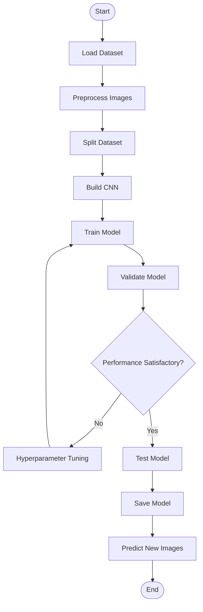

# Erkennung-von-Öberflachenfehlern-auf-Metall
## Überblick 
Dieses Projekt verwendet Methoden des Deep Learnings, um Öberflachenfehlern auf Metall zu erkennen. 
## Verwendete Python Bibliotheken 
- Tensorflow
- Numpy
- Matplotlib (für Graphen)
## ML-Pipleline

